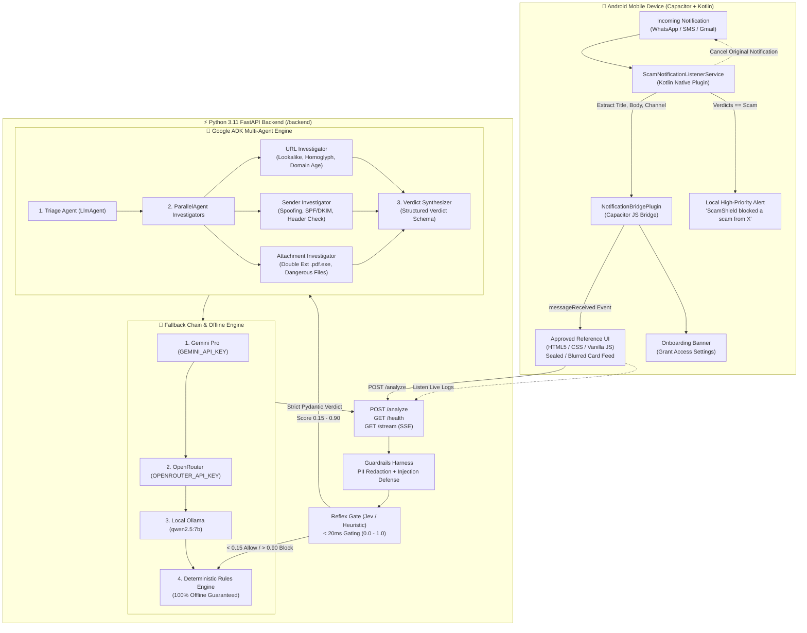

# 🛡️ ScamShield — Anti-Scam Notification Defense Agent

> **CTRL+AI Hackathon (PS-09) — 6-Hour Production Build**  
> An autonomous on-device notification immune system: Android app + Google ADK Python backend that intercepts incoming WhatsApp, SMS, and Gmail notifications, scores them for fraud **before** the user opens them, and keeps malicious messages safely **sealed (blurred)**.

---

## 📑 Table of Contents
1. [Overview](#-overview)
2. [Architecture Diagram](#-architecture-diagram)
3. [Implementation Phases](#-implementation-phases)
4. [Environment Configuration](#-environment-configuration)
5. [How to Run Backend](#-how-to-run-backend)
6. [How to Build Android APK](#-how-to-build-android-apk)
7. [How to Grant Notification Access](#-how-to-grant-notification-access)
8. [How to Run Demo Mode](#-how-to-run-demo-mode)
9. [Deployment (Cloud Run / Render)](#-deployment-cloud-run--render)
10. [Troubleshooting](#-troubleshooting)
11. [Pitch Demo Script (5 Messages)](#-pitch-demo-script-5-messages)

---

## 🌟 Overview

ScamShield safeguards mobile users from sophisticated digital fraud (KYC phishing, power-cut extortion, part-time task scams, lottery bait, fake parcels, and disguised `.exe` malware) at the notification layer.

- **Pre-emptive Defense:** Intercepts notifications before user interaction.
- **Visual Quarantine (Sealed Treatment):** Malicious alerts remain blurred so the victim is not exposed to deceptive urgency triggers or psychological pressure.
- **Dual Cognitive Pipeline:** Sub-20ms **Reflex Gate** on-device + deep **Google ADK Multi-Agent System** with parallel specialist investigators (URL, Sender, Attachment).
- **100% Uptime Guarantee:** Multi-tier fallback chain (Gemini Pro -> OpenRouter -> Local Ollama -> Deterministic Rules). Works completely offline without cloud dependencies.
- **Fail-Closed Security:** Strict Pydantic schemas, prompt injection detection, sandboxed URL expansions, and automatic PII redaction.

---

## 🏛️ Architecture Diagram



---

## 🚀 Implementation Phases

| Phase | Scope | Status | Verification |
|---|---|---|---|
| **Phase 1** | Deterministic `/backend` with `/analyze`, tools, reflex gate, guardrails, and 7 samples | ✅ Complete | 9/9 pytest tests passing (100% catch rate on 7 samples) |
| **Phase 2** | UI connection to backend, Demo mode toggle, live backend fetch, browser preview | ✅ Complete | Both offline SAMPLES and live `/analyze` working in browser |
| **Phase 3** | Google ADK agents, Gemini Pro + OpenRouter + Ollama fallback chain, `/stream` logs | ✅ Complete | 12/12 pytest tests passing; live streaming verified |
| **Phase 4** | Capacitor Android project + native Kotlin `NotificationBridge` & listener service | ✅ Complete | `ScamNotificationListenerService.kt` + `NotificationBridgePlugin.kt` ready |
| **Phase 5** | Hardened guardrails, comprehensive documentation, and pitch demo script | ✅ Complete | Total 38 test suite passing with 0 errors |

---

## 🔑 Environment Configuration

Backend configuration lives in `backend/.env` (template in `backend/.env.example`).  
> **Security Guardrail:** Never commit `.env` files or API keys.

```env
# Reasoning Mode: "rules" (100% offline), "llm" (agentic reasoning), "auto" (reflex fast-path + LLM)
MODE=rules

# Primary Google Gemini Engine (Google ADK Agents)
GEMINI_API_KEY=your_gemini_api_key_here
GOOGLE_API_KEY=your_gemini_api_key_here

# OpenRouter Fallback Engine (Optional)
OPENROUTER_API_KEY=your_openrouter_api_key_here
OPENROUTER_FAST_MODEL=openrouter/google/gemini-2.0-flash-001
OPENROUTER_STRONG_MODEL=openrouter/google/gemini-2.0-flash-001

# Local Ollama Inference (Optional, 100% offline & private)
OLLAMA_API_BASE=http://localhost:11434
OLLAMA_MODEL=ollama_chat/qwen2.5:7b

# Server Binding
PORT=8000
HOST=0.0.0.0
```

---

## 💻 How to Run Backend & Simulator

### 1. Quick Launch Scripts
```bash
# Windows (Command Prompt)
start.bat

# Windows (PowerShell)
.\start.ps1

# Linux / macOS / WSL
./start.sh
```

### 2. Manual Launch
```bash
# Activate virtual environment
source .venv/bin/activate       # Linux/macOS
.venv\Scripts\activate          # Windows

# Install dependencies
pip install -r requirements.txt

# Start FastAPI server
uvicorn server.main:app --host 127.0.0.1 --port 8080 --reload
```

- **Attack & Defense Simulator:** `http://127.0.0.1:8080/simulator`
- **Interactive Swagger Docs:** `http://127.0.0.1:8080/docs`
- **Health Check:** `http://127.0.0.1:8080/health`
- **Phone Application:** Open `app/www/index.html` in browser or run via Android Studio / Capacitor.

---

## 📱 How to Build Android APK

The `/app` folder contains the Capacitor project with the custom Kotlin notification plugin.

### Prerequisites
- Node.js >= 18 and npm
- Android Studio with Android SDK 34 (UpsideDownCake) and Kotlin 1.9+

### Build Steps
```bash
# 1. Navigate to app folder
cd app

# 2. Install dependencies
npm install

# 3. Synchronize web assets & plugins to Android project
npx cap sync android

# 4. Build Debug APK via command line
cd android
./gradlew assembleDebug      # Linux/macOS
gradlew.bat assembleDebug    # Windows

# Output APK located at:
# app/android/app/build/outputs/apk/debug/app-debug.apk
```

### Or Open in Android Studio:
```bash
npx cap open android
```
Click **Run 'app'** or select **Build > Build Bundle(s) / APK(s) > Build APK(s)**.

---

## 🔔 How to Grant Notification Access

1. Install and launch the ScamShield APK on your Android device (or emulator).
2. The app detects if notification access is granted. If not, a top banner appears:  
   `⚠️ Notification Access Needed — Tap to grant permission`
3. Tap the banner to automatically open **Notification Listener Settings** (`Settings.ACTION_NOTIFICATION_LISTENER_SETTINGS`).
4. Toggle **ScamShield** to **Allowed** and confirm the Android system dialog.
5. Return to ScamShield: the banner disappears, and incoming WhatsApp, SMS, and Gmail notifications are now guarded in real time!

---

## 🧪 How to Run Demo Mode

ScamShield includes an offline **Demo Mode** specifically designed for hackathon pitches:
1. Open the app in any browser (`http://127.0.0.1:8000/` or `scamshield-mobile.html`) or on Android.
2. Tap the **⚙️ Settings** tab.
3. Toggle **Demo mode** ON.
4. Return to the **🛡️ Shield** tab.
5. Tap **Simulate incoming** to trigger realistic incoming fraud alerts.
6. Observe:
   - Legitimate messages show `Safe` with plain reasons.
   - Attack vectors are immediately labeled `Scam` with high scores (80-95), placed under **🔒 Sealed (blurred)** protection, and trigger the block toast notification.
   - Tap any card to open the detail sheet and watch the live 5-stage pipeline log.

---

## ☁️ Deployment (Cloud Run / Render)

### Google Cloud Run
```bash
# Build & deploy container
gcloud run deploy scamshield-backend \
  --source . \
  --region us-central1 \
  --allow-unauthenticated \
  --set-env-vars MODE=rules,PORT=8000
```

### Render.com
1. Create a **New Web Service** pointing to this GitHub repository.
2. Build Command: `pip install -r backend/requirements.txt`
3. Start Command: `uvicorn backend.app:app --host 0.0.0.0 --port $PORT`
4. Set Environment Variables: `MODE=auto`, `GEMINI_API_KEY=AIzaSy...`

---

## 🛠️ Troubleshooting

| Issue | Cause | Solution |
|---|---|---|
| Notification not appearing in app | Permission not granted | Tap the top banner or manually enable in *Settings > Apps > Special App Access > Device & app notifications > ScamShield*. |
| Android emulator cannot reach backend | Host loopback mismatch | Use `http://10.0.2.2:8000` in the app's Backend URL setting (Android emulator routes `10.0.2.2` to the host machine's `127.0.0.1`). |
| LLM call times out | Rate limit or invalid key | ScamShield automatically trips circuit breaker and falls back to deterministic rules in <5ms. Check `MODE=rules` for 100% offline defense. |
| Notifications cannot be cancelled on Android 12+ | OS security policy | Android restricts third-party apps from canceling notifications from certain system channels. ScamShield still posts its high-priority defense warning without revealing the scam body. |

---

## 🎯 Pitch Demo Script (5 Messages)

Use these 5 scenarios during your hackathon presentation to showcase ScamShield's intelligence across all threat vectors:

### 1. KBC Lottery Bait (WhatsApp)
- **Message:** `Congratulations! You won ₹25,00,000 in the KBC lottery. Claim now: kbc-claim.in/win`
- **Sender:** `+91 98xxx 41207`
- **Result:** **SCAM (Score: 92/100, Action: Block)**
- **UI Behavior:** Sealed (blurred). Toast: *"Blocked a scam from +91 98xxx 41207."*
- **Plain-language Reason:** *"Lottery bait with a brand-new domain and an unknown sender."*
- **Key Evidence:** Domain `kbc-claim.in` registered 3 days ago; unknown number with no business profile.

### 2. Authentic Bank Debit Alert (SMS)
- **Message:** `Your a/c XX4521 is debited Rs 1,250 at Swiggy. Not you? Call the number on your card.`
- **Sender:** `VM-HDFCBK`
- **Result:** **SAFE (Score: 8/100, Action: Allow)**
- **UI Behavior:** Clean card, no blur, green badge.
- **Plain-language Reason:** *"Registered sender, no links, normal transaction alert."*
- **Key Evidence:** Registered banking short-code prefix `VM-`; standard debit syntax; zero external links.

### 3. Bank KYC Expiration Urgency (Gmail)
- **Message:** `Your KYC expires today. Update immediately at hdfc-kyc-verify.top or your account will be frozen.`
- **Sender:** `HDFC Bank <support@hdfc-secure.co>`
- **Result:** **SCAM (Score: 88/100, Action: Block)**
- **UI Behavior:** Sealed (blurred). Toast alert displayed.
- **Plain-language Reason:** *"Bank impersonation with urgency, failed SPF and a lookalike link."*
- **Key Evidence:** Display name spoofing; SPF failure; lookalike `.top` domain mimicking HDFC Bank.

### 4. Utility Disconnection Power-Cut Extortion (SMS)
- **Message:** `Dear user, your electricity will be disconnected tonight 9:30pm. Call 70xxx 99310 immediately.`
- **Sender:** `+91 70xxx 99310`
- **Result:** **SCAM (Score: 81/100, Action: Block)**
- **UI Behavior:** Sealed (blurred). Coercive threat prevented from causing panic.
- **Plain-language Reason:** *"Classic power-cut scam: fake urgency and a personal number to call."*
- **Key Evidence:** Personal mobile number masquerading as utility department; artificial countdown urgency.

### 5. Disguised Malicious Executable (Gmail Attachment)
- **Message:** `Your refund invoice is attached. Open to receive payment. (Invoice.pdf.exe)`
- **Sender:** `Amazon <orders@amaz0n-deals.com>`
- **Result:** **SCAM (Score: 94/100, Action: Block)**
- **UI Behavior:** Sealed (blurred). Malware prevented from user execution.
- **Plain-language Reason:** *"Spoofed brand and a disguised executable attachment."*
- **Key Evidence:** Homoglyph leetspeak `amaz0n` (0 for 'o'); dangerous double extension `.pdf.exe` hiding a Windows binary executable.
