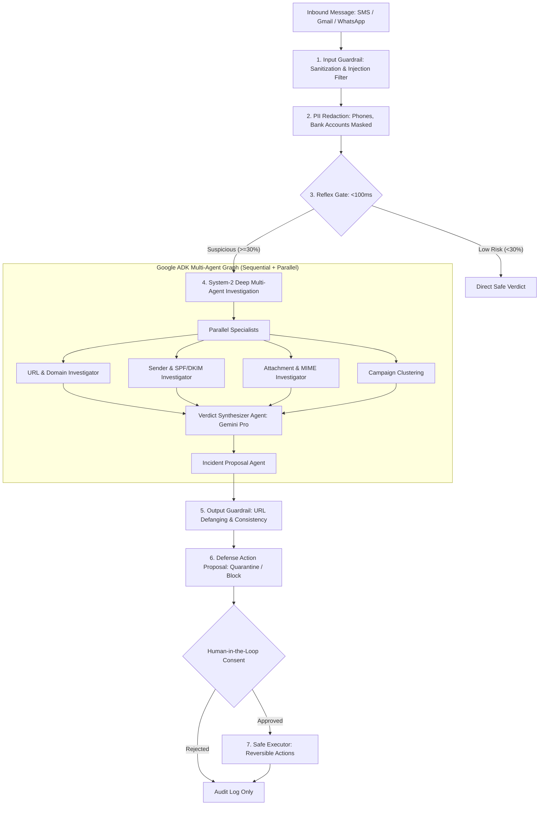

# 🛡️ ScamShield

> **An immune system for your inbox: Think fast. Think hard. Ask a human.**

[](LICENSE)
[](https://www.python.org/)
[](https://fastapi.tiangolo.com/)
[](https://github.com/google/agent-development-kit)
[-success.svg)](tests/)
[](harness/)

---

## 📸 Overview & Demo Preview

```
+-----------------------------------------------------------------------------------------+
|                                  SCAMSHIELD SIMULATOR                                   |
|  [ Preset: SBI KYC Phishing ]  -->  [ Reflex Gate: <100ms ]  -->  [ Multi-Agent Trace ] |
|                                                                                         |
|  VERDICT: SCAM (Risk Score: 100/100)                                                     |
|  Evidence: Domain registered 3 days ago · Phone reported 14x · Double-extension payload |
|  Proposed Action: Quarantine (Awaiting Human Approval)                                  |
|  [ Approve Action ]  [ Reject ]  [ Undo ]                                               |
+-----------------------------------------------------------------------------------------+
```

*(Placeholders for visual assets; place recordings and diagrams in `docs/images/`)*
- 
- 

---

## 💡 What It Does

ScamShield is an open-source, human-in-the-loop cognitive defense system that protects individuals from financial phishing, fake utility cutoffs, UPI refund traps, and malware attacks delivered via SMS, Gmail, and messaging apps.

Instead of relying on brittle keyword blacklists or opaque single-prompt LLM calls, ScamShield operates as a **two-speed cognitive defense architecture**:
1. **Reflex Triage Gate (System 1)**: Sub-100ms rapid triage powered by TypeSafe AI / Jev with cascading fallback to Gemini Flash structured output and offline deterministic rules.
2. **Deep Multi-Agent Investigation (System 2)**: Google ADK multi-agent orchestrator executing parallel specialist investigators (URL/WHOIS, Sender Reputation & SPF/DKIM spoof detection, and Attachment MIME threats).
3. **Explainable Bilingual Verdict**: Generates human-understandable verdicts citing concrete evidence in both English and regional languages (e.g., Tamil).
4. **Verifiable Human Consent**: The agent **only proposes** defensive mitigations (`quarantine`, `block_sender`, `block_url`). A human must explicitly approve actions. **Zero permanent deletion paths exist anywhere in ScamShield.**

---

## 🧬 Why ScamShield: The Immune System Analogy

Traditional spam filters operate like brick walls: either a message gets through uninspected, or it disappears silently into a junk folder with no explanation.

Biological immune systems solve threat detection differently:
- **Innate Immunity (Reflex Gate)**: Immediate, lightweight response that flags obvious pathogen patterns within milliseconds without exhausting bodily resources.
- **Adaptive Immunity (Deep Agent Investigation)**: Specialized white blood cells (URL, sender, and attachment investigators) coordinate in parallel to dissect sophisticated, novel attacks.
- **Immunological Memory (Campaign Tracking)**: Threat patterns from one vector are correlated across senders and channels to neutralize organized campaigns.
- **Self-Tolerance & Human Consent**: The immune system never attacks healthy host cells; similarly, ScamShield treats defense reversibility as a non-negotiable invariant. Reversible quarantine protects the user while preserving verifiable human override.

---

## 🏛️ Cognitive Architecture



---

## ✨ Features

- **Sub-100ms Reflex Triage**: Filters safe messages instantly while escalating threats to deeper scrutiny.
- **Parallel Google ADK Specialists**:
  - **URL Investigator**: Detects homoglyph lookalikes (`rn` vs `m`, `0` vs `o`), newly registered domains, and known malicious blocklists.
  - **Sender Investigator**: Correlates sender phone/email reputation, prior fraud reports, and validates SPF/DKIM email authentication.
  - **Attachment Investigator**: Detects dangerous double extensions (`.pdf.exe`), Windows PE binaries, and macro-enabled Office payloads.
  - **Campaign Clustering**: Groups related threats across numbers and channels into centralized threat campaigns.
- **5 Deterministic Safety Guardrails**: Hardened in Python code (input sanitization, PII masking, tool allowlists, output defanging, and action reversibility).
- **Resilient Fallback Routing**:
  - `Gemini 2.5 Pro` → `Gemini 2.5 Flash` → `OpenRouter` → `Local Ollama` → `Deterministic Rules Scorer`.
  - Zero downtime even during internet disconnects or API rate limits.
- **Interactive Attack & Defense Simulator**: Web-based mobile sandbox (`/simulator`) featuring preset attacks, live Server-Sent Events (SSE) telemetry, and human action buttons.
- **Native Android Phone Application**: Capacitor Android app (`/app`) with notification listener bridge and quarantine card display.
- **100% Offline Capability**: Runs completely without API keys using local deterministic heuristics.

---

## 🛠️ Tech Stack

| Layer | Technologies |
|---|---|
| **Backend & API** | Python 3.11+, FastAPI, Uvicorn, Pydantic v2, HTTPX |
| **Agent Framework** | Google ADK (`SequentialAgent`, `ParallelAgent`, `LlmAgent`) |
| **Model Providers** | Google Gemini 2.5 Pro / Flash, TypeSafe AI / Jev, LiteLLM, Ollama |
| **Frontends** | Vanilla JavaScript, HTML5, CSS3 (Simulator & Mobile Web UI) |
| **Mobile Runtime** | Capacitor 6, Android Studio, Kotlin Android Notification Bridge |
| **Testing & Safety** | Pytest, Safety Harness (Invariants I1–I8), Node.js test scripts |

---

## 📁 Project Structure

```
ScamShield/
├── .env.example                       # Documented environment template with placeholders
├── .gitignore                         # Comprehensive ignore rules (secrets, venvs, reports)
├── AGENTS.md                          # ScamShield architectural rules & coding guidelines
├── Dockerfile                         # Container definition for containerized deployment
├── LICENSE                            # MIT License
├── Makefile                           # Developer task runner (setup, run, test, harness)
├── README.md                          # Repository documentation & guide
├── requirements.txt                   # Pinned Python dependencies
├── app/                               # Native Android application & Web interface
│   ├── android/                       # Native Android Studio Gradle project
│   │   └── app/src/main/java/...      # Kotlin notification listener & bridge plugins
│   ├── www/index.html                 # Mobile UI application
│   ├── capacitor.config.json          # Capacitor bridge configuration
│   └── package.json                   # Mobile dependencies & Capacitor scripts
├── docs/                              # Technical documentation
│   ├── architecture.md                # In-depth cognitive architecture & guardrails
│   ├── api_reference.md               # Complete REST API & SSE event reference
│   ├── demo_script.md                 # 4-minute demo script & choreography guide
│   └── images/                        # Screenshots, diagrams, and media placeholders
├── guardrails/                        # Five-layer deterministic safety guardrails
│   ├── action_policy.py               # Reversible action allowlist & autonomy dial
│   ├── defang.py                      # URL defanging (hxxp://, [.])
│   ├── input_guard.py                 # Length cap, zero-width strip, prompt injection guard
│   ├── output_guard.py                # Grounding & score consistency validator
│   ├── redact.py                      # PII masking (phones, bank accounts, cards)
│   └── tool_guard.py                  # Agent tool execution allowlists & call budgets
├── harness/                           # Evaluation & safety verification harness
│   ├── invariants.py                  # Assertions for safety invariants I1 through I8
│   ├── report.py                      # HTML/JSON evaluation report generator
│   ├── run.py                         # Evaluation harness test runner CLI
│   └── suites/                        # Golden benchmark & adversarial test suites
│       ├── golden.json                # 20 real-world benchmark messages (12 scam, 8 safe)
│       └── adversarial.json           # 15 prompt injection & evasion attack cases
├── llm/                               # Multi-tier provider routing & fault tolerance
│   ├── providers.py                   # Gemini, LiteLLM OpenRouter, and Ollama configs
│   └── router.py                      # Fallback chain, circuit breaker, rate limit, cache
├── scamshield_agent/                  # Google ADK agent package
│   ├── agent.py                       # Root agent graph definition
│   ├── prompts.py                     # Specialized prompts for all agents
│   ├── schemas.py                     # Pydantic schemas (Verdict, Evidence, Incident)
│   ├── data/                          # Mock reputation datasets
│   │   ├── blocklist.json             # Malicious domains and numbers
│   │   ├── brands.json                # Verified brand domains & official keywords
│   │   ├── domain_reputation.json     # Mock WHOIS registration ages & report counts
│   │   └── sender_reputation.json     # Mock sender report counts & trust levels
│   └── tools/                         # Typed investigation tools
│       ├── attachment_tools.py        # Executable & macro attachment threat detector
│       ├── campaign_tools.py          # Threat clustering across senders/channels
│       ├── entities.py                # Entity extraction & PII redactor
│       ├── incident_tools.py          # Incident proposal & audit creation
│       ├── sender_tools.py            # Sender reputation & SPF/DKIM verification
│       └── url_tools.py               # Homoglyph lookalike & WHOIS age checks
├── scripts/                           # Cross-platform CLI task scripts
│   ├── setup.sh / setup.ps1           # Environment & dependency setup
│   ├── run.sh / run.ps1               # Launch backend server
│   ├── test.sh / test.ps1             # Run pytest suites
│   └── harness.sh / harness.ps1       # Run safety invariant harness
├── server/                            # FastAPI backend server
│   ├── cache.py                       # SHA-256 message-hash verdict cache
│   ├── executor.py                    # Reversible defense action executor
│   ├── main.py                        # REST API, SSE streaming, static file mounts
│   └── store.py                       # Thread-safe in-memory incident persistence
├── simulator/                         # Attack & Defense Simulator
│   ├── app.js                         # Preset attack scenarios, SSE stream, approval actions
│   ├── index.html                     # Simulated mobile chat interface
│   └── styles.css                     # Mobile frame styling, glow badges, agent nodes
├── tests/                             # Comprehensive test suites
│   ├── sample_messages.json           # 20 benchmark test cases
│   ├── rehearse_e2e.py                # End-to-end definition-of-done rehearsal script
│   ├── test_frontend_safeguards.js    # Node.js frontend safeguard assertions
│   ├── test_harness.py                # Safety harness integration test
│   ├── test_pipeline.py               # Full API pipeline & incident approval tests
│   ├── test_router.py                 # Outage failover, circuit breaker & cache tests
│   ├── test_tools.py                  # Unit tests for all investigation tools
│   └── test_triage.py                 # Unit tests for reflex rules & Jev fallback
├── start.bat                          # One-click Windows CMD startup launcher
├── start.ps1                          # One-click Windows PowerShell startup launcher
└── start.sh                           # One-click Linux / macOS startup launcher
```

---

## ⚡ Quick Start

Choose your platform to start the backend and launch the Attack Simulator:

### Windows (PowerShell)
```powershell
.\start.ps1
```

### Windows (Command Prompt)
```cmd
start.bat
```

### Linux / macOS
```bash
chmod +x start.sh
./start.sh
```

The launcher will automatically configure your `.venv`, install dependencies, generate `.env` from template, and launch the Message Simulator at **`http://127.0.0.1:8080/simulator`**.

---

## 📥 Detailed Installation & Download Guide

### 1. Prerequisites

Ensure the following tools are installed on your machine:
- **Python**: Version `3.11.x` is strongly recommended.
- **Git**: Latest version.
- **Node.js** *(Optional)*: Version `18.x` or `20.x` (only required if building/syncing Capacitor mobile assets).
- **Android Studio** *(Optional)*: Ladybug or newer (only required for building native Android APK).
- **Ollama** *(Optional)*: For running local LLMs offline. Download from [ollama.com](https://ollama.com/).

---

### 2. Step-by-Step Setup

#### Step A: Clone the Repository
```bash
git clone https://github.com/your-username/scamshield.git
cd scamshield
```

#### Step B: Create and Activate Virtual Environment

- **Linux / macOS**:
  ```bash
  python3 -m venv .venv
  source .venv/bin/activate
  ```
- **Windows (PowerShell)**:
  ```powershell
  python -m venv .venv
  .venv\Scripts\Activate.ps1
  ```
- **Windows (CMD)**:
  ```cmd
  python -m venv .venv
  .venv\Scripts\activate.bat
  ```

#### Step C: Install Dependencies
```bash
pip install -r requirements.txt
```

#### Step D: Configure Environment Variables
Copy the template configuration:
```bash
# Linux / macOS
cp .env.example .env

# Windows
copy .env.example .env
```

Open `.env` in your text editor. Obtain keys as needed:
- **Google Gemini API Key** *(Required for cloud agent reasoning)*: Get free from [Google AI Studio](https://aistudio.google.com/). Set `GOOGLE_API_KEY=AIzaSy...`.
- **TypeSafe AI / Jev Key** *(Optional)*: Get from [typesafe.ai](https://typesafe.ai/). Set `TYPESAFE_API_KEY=...`.
- **Local Ollama** *(Optional)*: If using Ollama, pull a model:
  ```bash
  ollama pull qwen2.5:7b
  ```

---

### 🚀 Running Without Any API Keys (100% Offline Mode)

ScamShield includes an instant offline fallback! If no API keys are provided in `.env`:
1. The **Reflex Gate** cascades to deterministic keyword and regex heuristics.
2. The **Model Router** falls back automatically to the offline rules scorer.
3. Full investigation, homoglyph lookalikes, SPF/DKIM validation, and action approvals run with **zero external network requests and 0ms latency**.

---

### 3. Launching the Services

#### Run the Backend Server
```bash
# Using Makefile
make run

# Or directly with Uvicorn
python -m uvicorn server.main:app --host 127.0.0.1 --port 8080 --reload
```

#### Access Operator Surfaces
- **Attack & Defense Simulator**: Open [http://127.0.0.1:8080/simulator](http://127.0.0.1:8080/simulator)
- **Phone Application (Web Preview)**: Open [http://127.0.0.1:8080/app](http://127.0.0.1:8080/app)
- **Interactive OpenAPI Documentation**: Open [http://127.0.0.1:8080/docs](http://127.0.0.1:8080/docs)

---

### 4. Running the Native Android Phone Application

The Android app runs as a native Capacitor application with background notification defense:

1. **Install Android dependencies**:
   ```bash
   cd app
   npm install
   ```
2. **Sync native assets**:
   ```bash
   npx cap sync android
   ```
3. **Open in Android Studio**:
   ```bash
   npx cap open android
   ```
4. **Point to Host Backend**:
   - When running on an **Android Emulator**, configure the backend URL in the app's Settings to:
     `http://10.0.2.2:8080` (Android emulator routes `10.0.2.2` to host machine `127.0.0.1`).
   - When testing on a **physical device**, ensure your phone is on the same Wi-Fi network and set the backend URL to your host machine's LAN IP (e.g., `http://192.168.1.50:8080`).
5. **Enable Notification Listener Permission**:
   - Navigate to *Settings > Apps > Special App Access > Device & app notifications > ScamShield* and grant permission.

---

## 🕹️ Usage Walkthrough

### Scenario 1: Analyzing an Attack in the Simulator
1. Open `http://127.0.0.1:8080/simulator`.
2. Select the preset **Fake SBI KYC Suspension** scenario:
   - Sender: `+91-98765-43210`
   - Body: *"Dear customer, your SBI net banking services are temporarily blocked due to pending KYC verification. Click: http://sbi-kyc-update.in/login"*
   - Attachment: `KYC_Verification_Form.pdf.exe`
3. Click **Inject Attack**.
4. Observe the live execution flow:
   - **Reflex Gate**: Identifies urgency (4/5) and flags high scam probability.
   - **Specialist Nodes**: The parallel agent network analyzes the domain registration, sender reputation, and executable attachment.
   - **Verdict**: Sealed card displays **SCAM (100/100)** with evidence citations.
   - **Consent**: A defense proposal (`quarantine`) is requested.
5. Click **Approve Action** to commit the quarantine to the audit trail.
6. Click **Undo Action** to demonstrate instant reversibility.

---

## ⚙️ Configuration Reference

| Environment Variable | Description | Default | Required? |
|---|---|---|---|
| `GOOGLE_API_KEY` | Google Gemini API key for deep multi-agent investigation | `""` | Optional (falls back to local rules) |
| `GOOGLE_GENAI_USE_VERTEXAI` | Whether to use Google Cloud Vertex AI instead of AI Studio | `FALSE` | Optional |
| `TYPESAFE_API_KEY` | TypeSafe AI / Jev API key for sub-100ms reflex triage | `""` | Optional (falls back to Flash / rules) |
| `TYPESAFE_BASE_URL` | Base URL for TypeSafe AI API endpoint | `https://api.typesafe.ai` | Optional |
| `TYPESAFE_MODEL` | TypeSafe AI model identifier | `jev-latest` | Optional |
| `JEV_API_KEY` | Alternative key alias for Jev reflex client | `""` | Optional |
| `JEV_BASE_URL` | Alternative base URL for Jev reflex client | `https://api.typesafe.ai` | Optional |
| `OLLAMA_API_BASE` | Base URL for local Ollama server | `http://localhost:11434` | Optional |
| `OLLAMA_MODEL` | Model tag for local Ollama LLM | `ollama_chat/qwen2.5:7b` | Optional |
| `HOST` | Backend server binding host address | `0.0.0.0` | Optional |
| `PORT` | Backend server listening port | `8080` | Optional |
| `SCAMSHIELD_ENV` | Environment identifier (`local`, `production`) | `local` | Optional |
| `ALLOWED_ORIGINS` | Comma-separated CORS allowed origins list | `http://localhost:8080,...` | Optional |

---

## 🛡️ Guardrails & Safety Invariants

ScamShield guarantees safety through **8 deterministic invariants (I1–I8)** tested continuously in `harness/`:

| Invariant | Safety Guarantee | Verification Method |
|---|---|---|
| **I1: No Deletion** | No code path can delete a message, contact, or file | Static AST check + runtime intercept |
| **I2: Consent Mandatory** | Actions in ask mode fail without explicit approval | Test unauthorized executor requests |
| **I3: Evidence Grounding** | Every cited evidence tool was actually executed | Validate execution provenance logs |
| **I4: Fail Closed** | Timeouts and errors never yield a "safe" verdict | Force injected provider faults |
| **I5: PII Redacted** | Raw phone numbers and account IDs never reach LLM | Scan prompt payloads prior to dispatch |
| **I6: Injection Resistant** | Adversarial text instructions never reduce risk score | Benchmark against 15 prompt injection attacks |
| **I7: Autonomy Bound** | Auto-actions strictly bounded by risk & evidence policy | Test threshold boundary violations |
| **I8: Defanged Output** | All URLs presented to users are defanged (`hxxp://`, `[.]`) | Regex validation on user explanations |

---

## 🧪 Testing & Verification

Run the complete test and verification suite:

```bash
# 1. Run unit and integration tests (28 passed)
pytest

# 2. Run the Safety & Invariants Evaluation Harness (I1-I8 passed)
python -m harness.run

# 3. Run frontend safeguard assertions
node tests/test_frontend_safeguards.js

# 4. Run TypeSafe SDK tests
node tests/test_typesafe_sdk.mjs

# 5. Run live end-to-end rehearsal (requires backend running)
python tests/rehearse_e2e.py
```

---

## ☁️ Deployment (Optional)

### Containerized Deployment (Docker)

A production-ready [Dockerfile](Dockerfile) is provided:

```bash
# Build the Docker container
docker build -t scamshield:latest .

# Run the container
docker run -p 8080:8080 --env-file .env scamshield:latest
```

### Google Cloud Run
Deploy directly from source:
```bash
gcloud run deploy scamshield \
  --source . \
  --port 8080 \
  --region us-central1 \
  --allow-unauthenticated
```

---

## 🔧 Troubleshooting

| Symptom | Cause | Solution |
|---|---|---|
| Port 8080 is already occupied | Prior server process listening on port | `start.ps1` and `start.sh` automatically terminate stale instances. Alternatively, run `netstat -ano \| findstr 8080` and stop the PID. |
| Android emulator cannot connect to backend | Loopback IP address mismatch | In the app's settings, set Backend URL to `http://10.0.2.2:8080` (do not use `127.0.0.1` inside the emulator). |
| Physical phone cannot reach backend | Firewall or different Wi-Fi subnet | Ensure phone and computer are on the same Wi-Fi network and allow port 8080 through the host OS firewall. |
| LLM API rate limits or network timeout | Quota exceeded or temporary outage | ScamShield automatically trips circuit breakers and fails over to local rules in <5ms. |
| Missing notifications on Android 12+ | OS notification listener restriction | Manually grant permission in *Settings > Apps > Special App Access > Device & app notifications*. |

---

## ⚠️ Limits & Responsible Use

> [!IMPORTANT]
> - **Mock Threat Intelligence**: All domain reputation metrics, WHOIS registration ages, and sender fraud reports in `scamshield_agent/data/` are **synthetic mock datasets** created strictly for prototype demonstration and testing.
> - **Prototype Decision Support**: ScamShield is designed as a **decision-support advisory system**. It assists users in identifying deceptive patterns but does not replace professional financial or legal counsel.
> - **Synthetic Test Payloads**: All sample messages in `tests/sample_messages.json` and harness suites utilize fictionalized phone numbers and non-resolving domains (`*.click`, `*.in`, `*.vip`). Do not use real victim messages containing sensitive credentials for testing.
> - **Non-Destructive Guarantee**: ScamShield does **not** permanently delete messages or modify user communication accounts. All defense interventions are isolated to reversible sandboxes.

---

## 🗺️ Roadmap

- [ ] **On-Device Small Language Model (SLM)**: Integrate Gemma 2B / Qwen2.5 on-device via MLC-LLM / WebGPU for zero-cloud mobile reasoning.
- [ ] **Real-Time Telecom & Bank Threat Feeds**: Connect verified threat feeds (e.g. Chakshu, Indian Cybercrime Coordination Centre (I4C), PhishTank).
- [ ] **Family Guardian Console**: Multi-device dashboard enabling family administrators to assist elderly relatives with flagged scam escalations.
- [ ] **Voice-Call Scam Shield**: Real-time speech-to-text audio triage detecting digital arrest and extortion patterns during inbound phone calls.

---

## 🤝 Contributing

Contributions are welcomed! Please review:
- [CONTRIBUTING.md](CONTRIBUTING.md) for development workflows and coding standards.
- [SECURITY.md](SECURITY.md) for vulnerability disclosure and credential policies.
- [AGENTS.md](AGENTS.md) for agent architectural constraints.

---

## 📄 License

ScamShield is licensed under the [MIT License](LICENSE).

---

## 👏 Credits & Acknowledgments

- **Google Agent Development Kit (ADK)**: Multi-agent orchestration and schema-enforced LLM agents.
- **Google Gemini**: Multimodal and agentic reasoning engines (Gemini 2.5 Pro & Flash).
- **TypeSafe AI**: High-velocity structured reflex triage SDK.
- **FastAPI**: Asynchronous web framework and Server-Sent Events infrastructure.
