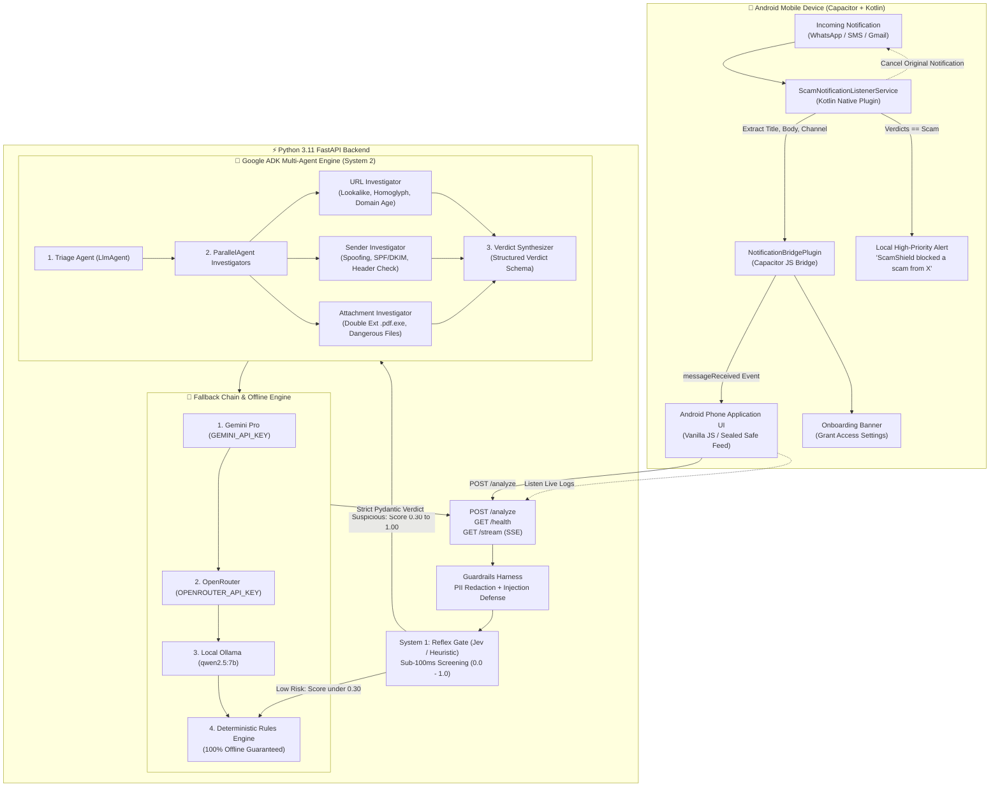
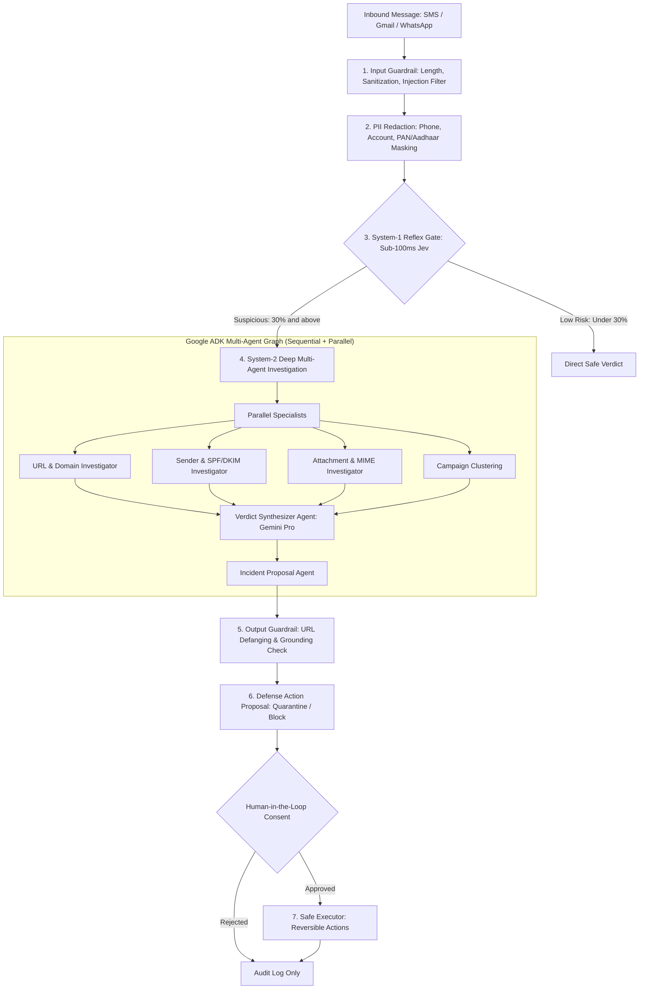

# 🏛️ ScamShield Architecture

## 1. System Architecture Diagram

## 2. Cognitive Architecture: Two-Speed Defense

ScamShield implements a **two-speed cognitive defense architecture** with verifiable human consent, resilient provider failover, and strict safety invariants:

---

## 3. Five-Layer Safety Guardrails

Safety invariants are enforced by deterministic Python modules rather than relying on LLM self-policing:

1. **Input Guard (`guardrails/input_guard.py`)**:
   - Caps input lengths to prevent prompt-flooding buffer attacks.
   - Strips dangerous zero-width Unicode characters and homoglyph exploits.
   - Detects prompt injection markers (`Ignore previous instructions`, etc.).
   
2. **PII Redaction Guard (`guardrails/redact.py`)**:
   - Redacts Indian and international phone numbers (`+91...`).
   - Redacts bank account numbers and 16-digit card numbers.
   - Defangs dangerous URLs into inert text strings before LLM exposure.

3. **Tool Guard (`guardrails/tool_guard.py`)**:
   - Enforces strict tool execution allowlists per agent role.
   - Prevents unauthorized cross-tool access or recursion loops.
   - Enforces call count budgets per investigation stage.

4. **Output Guard (`guardrails/output_guard.py`)**:
   - Validates that every verdict risk score matches the cited evidence severity.
   - Ensures all URLs displayed in explanations are defanged (`hxxp://`, `[.]`).
   - Enforces grounding checks to ensure no hallucinated threat sources.

5. **Action Policy Guard (`guardrails/action_policy.py` & `server/executor.py`)**:
   - Agents **only propose** defense actions; they have zero direct execution privileges.
   - Execution is restricted to reversible operations: `quarantine`, `block_sender`, `block_url`.
   - **Zero permanent deletion paths exist anywhere in the codebase.**
   - All approved and rejected actions are permanently recorded in an append-only audit trail.

---

## 4. Resilient Provider Routing & Fallback Chain

ScamShield ensures defense continuity during cloud API failures or rate limits via `llm/router.py`:

```mermaid
graph LR
    Req[Message Payload] --> GPro[Gemini 2.5 Pro]
    GPro -- "Failure / Timeout / Circuit Open" --> GFlash[Gemini 2.5 Flash]
    GFlash -- "Failure / Timeout" --> OpenRouter[LiteLLM OpenRouter]
    OpenRouter -- "Failure / Timeout" --> Ollama[Local Ollama: Qwen2.5]
    Ollama -- "Failure / Offline" --> Rules[Deterministic Rules Scorer]
    Rules --> Res[Guaranteed Safe Verdict]
```

- **Circuit Breaker:** Automatically trips after consecutive upstream failures, preventing latency spikes.
- **Verdict Cache:** SHA-256 message-hash caching delivers instant (0ms) duplicate analysis.
- **Fail-Closed Guarantee:** Errors or timeouts default to `needs_review` or suspicious evaluation—never silently labeled `safe`.
